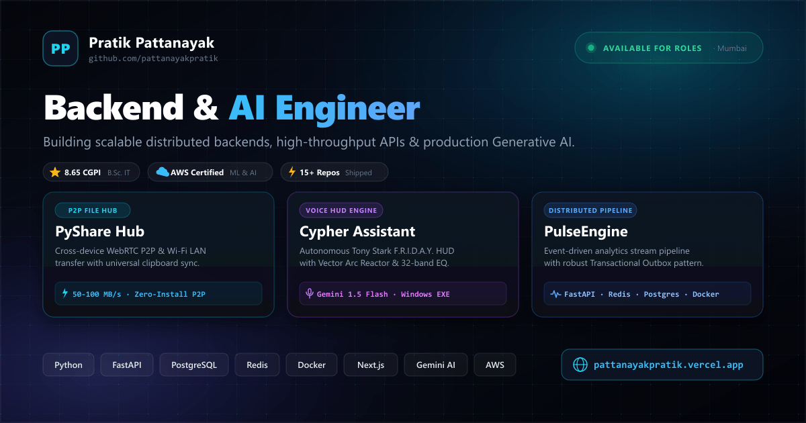
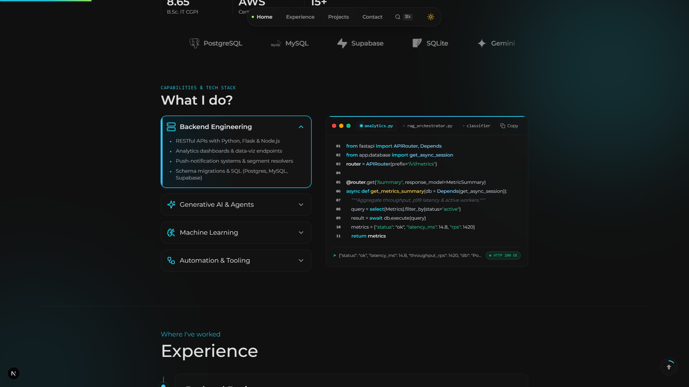
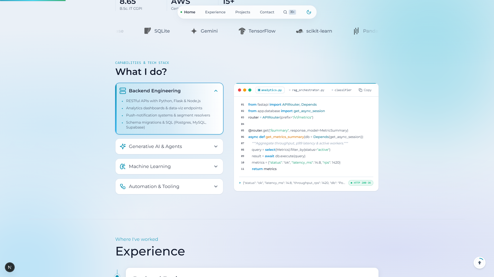

<div align="center">

# 🌐 Pratik Pattanayak — Portfolio

**High-Performance Personal Engineering Portfolio & Showcase**  
*Architecting scalable distributed backends, analytical APIs & production Generative AI.*

[](https://github.com/pattanayakpratik/my_portfolio/actions/workflows/deploy.yml)


<br />

<a href="https://pattanayakpratik.vercel.app/">
  
</a>

<br />
<br />

[**Explore Live Deployment ↗**](https://pattanayakpratik.vercel.app/) &nbsp;·&nbsp; [**Engineering Case Studies ↗**](https://pattanayakpratik.vercel.app/notes) &nbsp;·&nbsp; [**PyShare Showcase ↗**](https://pattanayakpratik.vercel.app/projects/pyshare) &nbsp;·&nbsp; [**Cypher HUD ↗**](https://pattanayakpratik.vercel.app/projects/cypher)

</div>

---

## 📌 Overview

This repository powers **[pattanayakpratik.vercel.app](https://pattanayakpratik.vercel.app)** — an interactive portfolio engineered for **Pratik Pattanayak**, a Backend & AI Engineer and AWS-certified ML practitioner. 

Built with **Next.js 16 (App Router)**, **React 19**, and **Tailwind CSS**, the application incorporates modern design principles inspired by ColorOS 17 and iOS 18 Living Flow fluid glassmorphism, paired with zero-lag scrollspy navigation, dual light/dark themes, and complete automated testing coverage across both Node.js and Python.

---

## 🎨 Design System & Visual Architecture

### 🌓 Dual Theme System (Instant, Zero-Flicker Toggle)

| Theme | Aesthetic & Color Palette | Visual Hierarchy |
| :--- | :--- | :--- |
| **Dark Mode** | **Deep Obsidian & Neon Cyan**<br>`#060913` canvas, cyan `#06B6D4` / `#22D3EE` glows, deep violet `#6366F1` accents | Drifting liquid gradient meshes, hairline glass borders (`rgba(255, 255, 255, 0.12)`), and cybernetic grid textures. |
| **Light Mode** | **Soft Porcelain & Milk-Quartz Glass**<br>`#F4F7FC` soft porcelain base, `#0F172A` deep ink text, `#475569` muted slate | 40–50% dense milk-glass card fills, deep 3D ambient elevation (`box-shadow: 0 10px 30px -10px rgba(15, 23, 42, 0.08)`), and high-contrast hover icons. |

<p align="center">
  
  
</p>

---

## 🚀 Flagship Projects Showcase

### 1. [PyShare Hub](https://pattanayakpratik.vercel.app/projects/pyshare) — Cross-Device File Transfer & Universal Clipboard
* **Zero-Install WebRTC P2P**: Instant peer-to-peer browser file sharing at `pyshare.vercel.app` with zero cloud uploads or storage limits.
* **Offline LAN Wi-Fi Engine**: 50–100 MB/s high-speed local transfer with multi-threaded streaming via pure Python sockets.
* **Universal Clipboard**: Live text and URL sync across phones, laptops, and desktop machines on the same network.
* **Standalone Windows Executable**: Bundled portable executable featuring an integrated Cloudflare Tunnel and HTTP 206 partial content streaming.

### 2. [Cypher AI](https://pattanayakpratik.vercel.app/projects/cypher) — Holographic F.R.I.D.A.Y. Desktop HUD
* **Vector Arc Reactor Visualizer**: 4 reactive HUD telemetry states (`Standby`, `Listening`, `Processing`, `Speaking`).
* **32-Band Audio Spectrum Equalizer**: Real-time FFT audio visualizer rendering live microphone frequencies at 60 FPS.
* **Multi-Model Intelligence**: Natural language desktop system automation powered by Google Gemini 1.5 Flash.

### 3. PulseEngine — Distributed Analytics & Transactional Outbox Pipeline
* **High-Concurrency Stream**: Real-time event analytics stream handling simulated high-throughput event ingestion.
* **Guaranteed Delivery**: Transactional Outbox pattern implemented with **FastAPI**, **Redis**, and **PostgreSQL** in Dockerized isolation.

---

## ⚡ Key Engineering Highlights

* **Zero-Lag Scrollspy with Hysteresis Deadband**: Replaced edge-threshold checking with a focal reading zone (`window.innerHeight * 0.35`) and an 80px hysteresis deadband (`±50px`), eliminating navigation flickering across section transitions.
* **Isolated Re-render Architecture**: Live local time badges and dynamic components run in isolated micro-components (`<LiveTimeBadge />`), preventing unnecessary root-level re-renders.
* **High-Impact Bento Social Cards (1200 × 630)**: Social link sharing generates matching OpenGraph bento previews deterministically via Sharp (`public/og.image.png`) and dynamically via Next.js Edge (`src/app/opengraph-image.tsx`).
* **Engineering Notes & Case Studies (`/notes`)**: Technical deep dives documenting distributed systems benchmarks, WebRTC data channel tuning, and memory management.
* **Instant Scroll Restoration**: Inter-page links dynamically restore viewport to top (`scrollY = 0`), while in-page anchors retain smooth scrollspy tracking.

---

## 🛠️ Tech Stack & Tooling

| Layer | Technologies |
| :--- | :--- |
| **Framework & Engine** | Next.js 16 (App Router), React 19, TypeScript 6.0 |
| **Styling & Effects** | Tailwind CSS 3.4, PostCSS, Lucide React Icons |
| **Image Processing** | Sharp (SVG-to-PNG vector rasterization) |
| **Cloud & Analytics** | Vercel Analytics, Vercel Speed Insights, Firebase Firestore |
| **Testing Harness** | Node.js Test Runner (`node:test`), Python Test Suite (`unittest`) |
| **CI/CD Automation** | GitHub Actions (`deploy.yml` multi-stage lint, test, build, and deploy) |

---

## 🧪 Automated Testing Suite

The repository incorporates dual-stack test automation ensuring zero regressions across routes, data models, static assets, and terminal interpreters:

```bash
# Run both Node.js and Python test suites
npm test

# Run TypeScript static analysis without emit
npm run typecheck

# Run Next.js production build verification
npm run build
```

### Test Suites Included:
* **Node.js (`tests/portfolio.test.js`)**: Validates profile identity invariants, flagship banner dimensions, and App Router page structures.
* **Python (`tests/test_profile_data.py`)**: Checks data integrity in `profile.ts` (social links, stats, skill mappings).
* **Python (`tests/test_project_assets.py`)**: Verifies asset presence, dimensions, and aspect ratios for all showcases.
* **Python (`tests/test_routing_and_pages.py`)**: Verifies App Router conventions, dynamic OG routes, and manifest web standards.
* **Python (`tests/test_terminal_commands.py`)**: Tests CLI shell commands and interpreter outputs.

---

## 📁 Repository Structure

```text
my_portfolio/
├── .github/
│   └── workflows/
│       └── deploy.yml            # Automated CI/CD pipeline (Test, Build, Deploy)
├── public/
│   ├── certifications/           # Verified AWS & academic PDF documents
│   ├── fonts/                    # Self-hosted Montserrat variable fonts
│   ├── projects/                 # Flagship showcases (Cypher HUD & PyShare)
│   ├── svg/tech/                 # Marquee tech stack vectors
│   ├── og.image.png              # 1200x630 Glassmorphic Bento OpenGraph preview
│   └── Pratik_Pattanayak_Resume.pdf
├── scripts/
│   └── generate_og_image.mjs     # Deterministic OpenGraph image generator (Sharp)
├── src/
│   ├── app/
│   │   ├── layout.tsx            # Root layout with metadataBase & SEO tags
│   │   ├── globals.css           # Design tokens, porcelain light & obsidian themes
│   │   ├── opengraph-image.tsx   # Dynamic Next.js Edge OpenGraph generator
│   │   ├── twitter-image.tsx     # Twitter Card edge metadata
│   │   ├── notes/                # Technical case studies & engineering notes
│   │   └── projects/             # Detailed showcase pages (Cypher, PyShare)
│   ├── components/               # Modular UI components (Nav, Hero, Bento, Terminal)
│   └── data/
│       ├── profile.ts            # Single source of truth for portfolio content
│       └── caseStudies.ts        # Technical architecture write-ups
└── tests/                        # Multi-language test suites (Node.js & Python)
```

---

## 💻 Local Development

### Prerequisites
* **Node.js** (v20 or higher recommended)
* **Python** (v3.10 or higher for running tests)
* **npm**

### Setup Steps
```bash
# 1. Clone the repository
git clone https://github.com/pattanayakpratik/my_portfolio.git
cd my_portfolio

# 2. Install dependencies
npm install

# 3. Start local development server
npm run dev
```

Visit `http://localhost:3000` to preview the portfolio locally with hot module replacement.

---

## 📬 Contact & Connect

* **Portfolio**: [pattanayakpratik.vercel.app](https://pattanayakpratik.vercel.app)
* **GitHub**: [@pattanayakpratik](https://github.com/pattanayakpratik)
* **LinkedIn**: [in/pattanayakpratik](https://www.linkedin.com/in/pattanayakpratik)
* **Email**: [mr.pratikpattanayak@gmail.com](mailto:mr.pratikpattanayak@gmail.com)

---

<div align="center">
  <sub>Crafted with passion, precision, and modern web standards. © 2026 Pratik Pattanayak.</sub>
</div>
